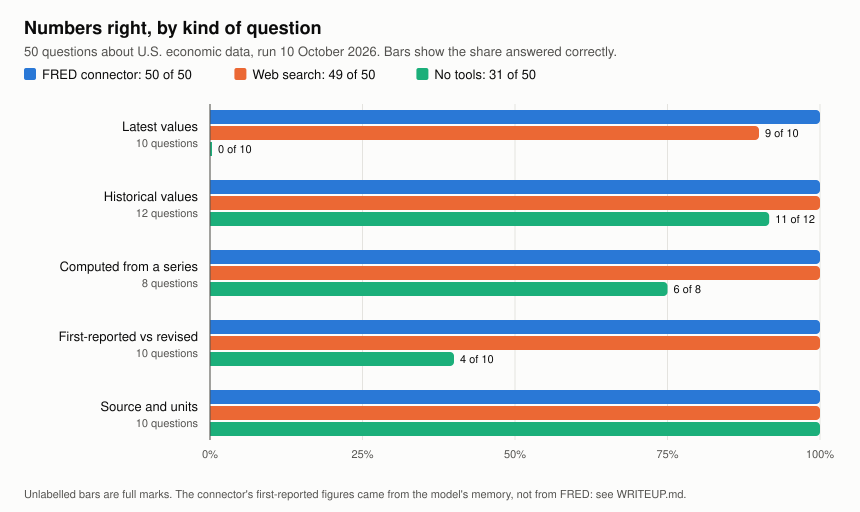

# FredCheck

50 questions about U.S. economic data, with answers computed from FRED and ALFRED, put to an AI assistant three ways: with FRED's official MCP connector, with web search, and with no tools. Each answer is scored for the right number, the right period and the right source.

- `questions.json`: the questions, by category (L latest, H historical, C computed, V vintage, A attribution), each with a machine-readable spec.
- `build_key.py`: computes `key.json` from FRED's public CSVs on the day of a run, since latest values move.
- `RUNBOOK.md`: how a run is done and scored.
- `runs/<date>/`: every answer, every score with a one-line reason, and `RESULTS.md`.
- `.claude/agents/`: the three arm definitions (Claude Code subagents).
- `fred_auth.py`, `fred_call.py`: sign in to the connector, and call its tools from the command line.

`WRITEUP.md` reports the 2026-10-10 run: connector 50 of 50 numbers right, web search 49, no tools 31. The connector has no vintage or as-of option, so its first-reported figures came from the model's memory. The 2026-10-06 run is a draft; see its `RESULTS.md` for how it differed from the runbook.

The repo holds only the few data values the questions need, each cited to its FRED series. Some series belong to their producers (S&P Dow Jones Indices, the University of Michigan), and FRED's terms of use apply to them.

## Licence

The code is under the MIT License (`LICENSE`). The questions, write-up and results are under CC BY 4.0. FRED data values stay under FRED's terms. See `LICENSE-CONTENT.md`.

FRED is a trademark of the Federal Reserve Bank of St. Louis. This project is independent and not affiliated with or endorsed by the St. Louis Fed or Anthropic.

This product uses the FRED® MCP Connector but is not endorsed or certified by the Federal Reserve Bank of St. Louis.
